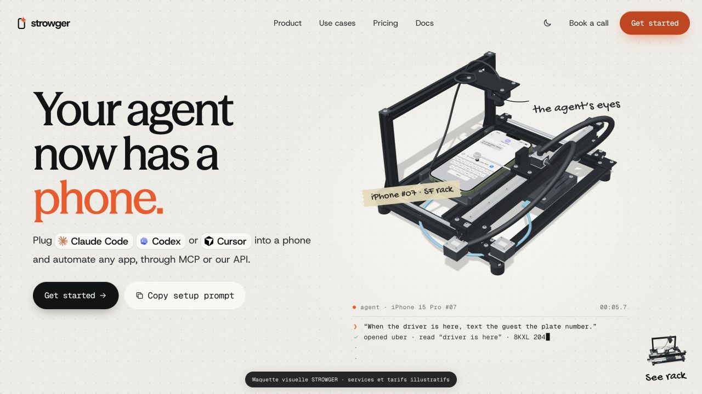
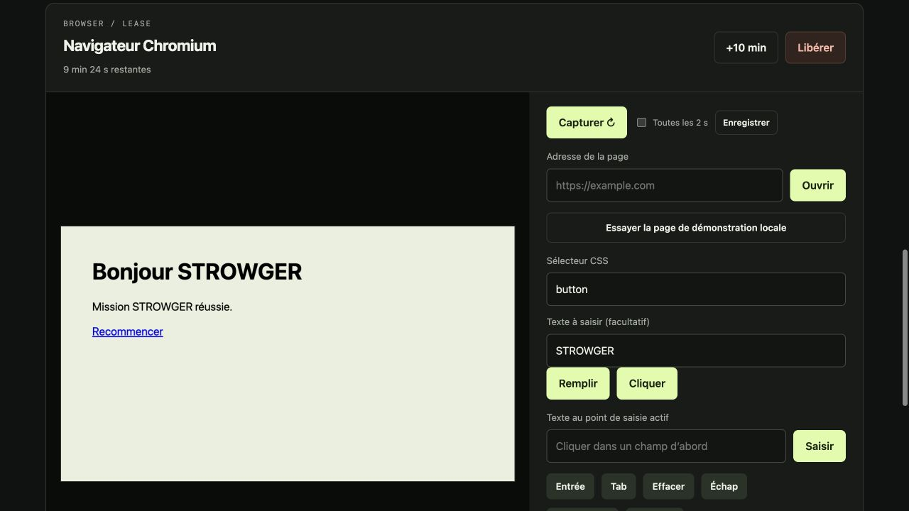

# Open Phone Use · 0.4.0

**Un agent réserve un environnement, agit, puis le libère.**

Un runtime local expérimental pour vos agents GETA / STROWGER, avec une API HTTP et un SDK Python. Aucun fournisseur LLM ni abonnement cloud nécessaire pour la démonstration.

```python
from strowger_env.client import Runtime

with Runtime("http://127.0.0.1:8876", api_key) as runtime:
    with runtime.browser.acquire(ttl=300) as lease:
        lease.act("navigate", url="https://example.com")
        print(lease.act("observe"))
# Le context manager appelle lease.release().
```

## Tout le projet dans ce dépôt

[Site public](https://strowger-environments.elnh.chatgpt.site/) · [Guide public de reproduction](https://strowger-environments.elnh.chatgpt.site/docs) · [Télécharger toutes les sources](https://github.com/strowgerV1/open-phone-use/archive/refs/heads/main.zip)

| Dossier ou fichier | Contenu |
|---|---|
| [`site/`](site/) | Site complet : HTML, CSS, JavaScript, polices, vidéos, modèle 3D, textures et décodeurs |
| [`strowger_env/`](strowger_env/) | API de leases et jobs, console locale, SDK Python synchrone/asynchrone, adaptateurs Chromium, Linux Docker et Android ADB/UIAutomator2, pool Cuttlefish préprovisionné et viewer scrcpy local |
| [`docker/`](docker/) | Image reproductible du bureau Linux |
| [`scripts/`](scripts/) et [`Banc-telephones.command`](Banc-telephones.command) | Installation et lancement du banc local |
| [`tests/`](tests/) et [`.github/workflows/`](.github/workflows/) | Tests automatisés et vérification continue |
| [`docs/`](docs/) et [`DEMAIN.md`](DEMAIN.md) | Protocole, architecture et préparation du parc physique |
| [`docs/visual-review/`](docs/visual-review/) | Comparaisons visuelles et captures des sections du site |





Les clés, inventaires USB privés, captures de futurs appareils et journaux d’exécution restent locaux. Les dépendances et fichiers de build sont recréés à l’installation. Voir [LICENSE](LICENSE) et [site/NOTICE.md](site/NOTICE.md) pour les périmètres de licence.

## Ce qui fonctionne

| Ressource | Implémentation | Validation locale du 23 octobre 2026 |
|---|---|---|
| Browser | Chromium dédié à chaque lease ; navigation, observation, clic, saisie, capture | Mission réelle et séparation de deux sessions testées |
| Desktop | Desktop Linux X11 dans Docker ; capture, clic, texte, touches | Test Docker réel réussi dans la suite 0.4.0 |
| Phone | Android ADB ou UIAutomator2, actions structurées, exclusivité et quarantaine des mutations incertaines | providers factices vérifiés ; aucun appareil connecté pour validation matérielle |
| Cuttlefish | Pool déjà provisionné via cvdr, accès ADB sous lease | providers factices vérifiés ; aucune VM créée ni hôte KVM local |
| iOS, Windows VM, portique robotisé | À développer | Non disponibles |

Le site dans `site/` est une **maquette locale rebrandée de PhoneUse**, demandée pour étude visuelle. Ses ressources tierces, sa police, son modèle 3D et son code ne sont **pas couverts par notre licence MIT**. Les tarifs, la flotte et les performances montrés sont ceux de la maquette source, pas des services STROWGER disponibles. L’utilisateur a confirmé disposer des autorisations de réutilisation pour cette publication ; cela ne relicencie pas ces éléments sous MIT. Voir `site/NOTICE.md`.


## La console, utilisable maintenant

```sh
.venv/bin/strowger serve --capacity 6 --port 8876 --open
```

Sur Mac, double-cliquer sur **Banc-telephones.command**, puis choisir **3**. Le serveur reste dans Terminal et ouvre la console sur `http://127.0.0.1:8876/`. Un code de connexion à usage unique (2 minutes) ouvre une session opérateur de 12 h ; la clé API n’est jamais renvoyée au navigateur. Sans `--open`, la page accepte votre clé locale dans un champ masqué.

La console permet de réserver plusieurs ressources, afficher et enregistrer leurs captures, cliquer directement dans l’image, saisir, défiler, renouveler et libérer. Les Android acceptent aussi un glissement tactile et le lancement d’une application par son package. Une capture automatique toutes les 2 s est facultative ; ce n’est pas un flux vidéo. Les leases de cet onglet sont retrouvées après actualisation. Une déconnexion libère les sessions de l’onglet ; fermer simplement l’onglet laisse leur TTL expirer.

**Premier essai sans téléphone** : réserver un navigateur → « Essayer la page de démonstration locale » → remplir `#name` avec STROWGER → cliquer sur `button` → vérifier « Bonjour STROWGER » → Libérer. Les actions sont réelles et aucun téléphone fictif n’apparaît dans le parc.

## Pilote prêt pour 5 à 6 téléphones

Sur Mac, ouvrir **[Banc-telephones.command](Banc-telephones.command)**. Le menu propose diagnostic USB, inscription des Android autorisés, ouverture de la console, préparation Docker et tests volontaires HOME/capture/libération. Voir **[DEMAIN.md](DEMAIN.md)** pour le déroulé du premier essai.

```sh
sh scripts/preparer-pilote.sh
strowger doctor
strowger enroll --owner alice --limit 6
strowger serve --capacity 6 --port 8876 --open
# Dans un autre terminal, après chargement de .venv :
strowger smoke --url http://127.0.0.1:8876 --limit 2
```

`strowger` est installé dans `.venv/bin/` : activer `.venv` ou utiliser le chemin complet. L’inventaire opérateur est stocké dans `data/fleet.json` et les clés dans `.env`, tous deux privés et ignorés par Git. Le diagnostic distingue logiciel installé et matériel prêt. `smoke` est une action explicite de test matériel, jamais lancée automatiquement. La capacité est configurable avec `ENV_CAPACITY` (1 à 64, défaut 4 hors configuration pilote). Le pilote généré utilise 6.

## Démarrer en local

Prérequis : Python 3.11+ ; internet pour télécharger Chromium et les dépendances. macOS/Linux pour ce quickstart. Docker est facultatif pour le navigateur et nécessaire pour le desktop Linux.

```sh
python3 -m venv .venv
. .venv/bin/activate
pip install -r requirements.lock
pip install .
playwright install chromium
# Sous Linux : playwright install --with-deps chromium
strowger init --capacity 6
strowger serve --capacity 6 --port 8876 --open
```

Dans un second terminal, depuis le même dossier :

```sh
. .venv/bin/activate
python examples/browser_demo.py
```

Résultat attendu : `Bonjour STROWGER`, une image `demo.png`, puis libération automatique du navigateur. La page de test est locale ; aucune inscription réelle ni action sur un service externe.

Documentation API interactive : <http://127.0.0.1:8876/docs>.

## Activer le desktop

```sh
.venv/bin/strowger desktop
# Relancer le serveur après ce changement.
```

```python
with runtime.desktop.acquire(ttl=60) as lease:
    image = lease.act("screenshot")   # png_base64
    lease.act("tap", x=200, y=200)
    lease.act("type", text="hello")
```

Chaque lease réserve un nouveau conteneur : aucun réseau, aucun dossier hôte monté, utilisateur non-root, capabilities retirées, limites CPU/RAM/PID. Un terminal reste un terminal : toute commande saisie peut s’exécuter dans ce conteneur. Ce n’est pas une VM ni une isolation suffisante pour du code hostile. La commande `strowger desktop` construit l’image et active le fournisseur dans `.env`. Le broker nécessite l’accès au daemon Docker ; ne jamais exposer ce daemon aux agents.

## Connecter un Android de laboratoire

Installer Android SDK Platform Tools depuis la source officielle ; activer le débogage USB sur un appareil dédié, et autoriser la connexion sur cet appareil.

```sh
adb devices
export ENV_ANDROID_SERIAL=emulator-5554  # remplacer par l’identifiant exact
# Relancer le serveur.
```

```python
with runtime.phone.acquire(ttl=60) as lease:
    image = lease.act("observe")
    lease.act("tap", x=100, y=200)
    lease.act("key", key="BACK")
```

Plusieurs téléphones peuvent avoir chacun une lease exclusive. UIAutomator2 est facultatif (`pip install '.[android]'`) et expose une hiérarchie bornée et des sélecteurs strictement structurés. Les leases peuvent lancer un viewer scrcpy local en lecture seule si l’opérateur active `ENV_SCRCPY_ENABLED=1`. Les scénarios déterministes utilisent les jobs déclaratifs; un agent avec modèle externe utilise `AsyncRuntime` et garde la décision dans son propre client. Aucun LLM n’est inclus. Pour les détails de flotte, clés dédiées, hubs, tunnel privé et limites de jobs, lire [le guide clients et flottes](docs/CLIENT_FARMS.md) et [le guide Android physique](docs/PHYSICAL_FLEET.md). La libération revient à HOME sans réinitialiser les applications ni les données.

## Tester

```sh
pytest -q
ENV_DESKTOP_TEST=1 pytest -q tests/test_desktop.py
```

La suite vérifie aussi les routes jobs, les ACL, les annulations, les quarantaines et les providers simulés UIAutomator2, scrcpy et Cuttlefish. Le test desktop réel est désactivé par défaut ; il exige Docker et l’image construite. Les tests Android et Cuttlefish sur matériel sont opt-in et ne sont pas déclarés réussis dans cette livraison.

## Explorer la maquette

```sh
cd site
npm run dev -- --host 127.0.0.1 --port 4173
```

Ouvrir <http://127.0.0.1:4173>. Les animations utilisent les ressources récupérées sur PhoneUse : il s’agit d’une reproduction locale d’étude, pas d’une création originale. Les formulaires et boutons commerciaux ne déclenchent aucune commande réelle.

## Documentation

- [Flotte Android physique et recette hardware](docs/PHYSICAL_FLEET.md)
- [Exploiter une flotte par client](docs/CLIENT_FARMS.md)
- [Cuttlefish préprovisionné](docs/CUTTLEFISH.md)
- [Protocole et intégration](docs/PROTOCOL.md)
- [Architecture, limites et passage au cloud](docs/ARCHITECTURE.md)
- [Projets consultés et attribution](docs/SOURCES.md)
- [Contribuer](CONTRIBUTING.md)

Cette version est mono-processus et pour des agents de confiance. Le lanceur CLI empêche deux brokers dans le même dossier de données. L’état des leases est en mémoire et la console reste sur la boucle locale ; elle n’est pas un cloud hébergé. Les clés sont configurées par l’opérateur ; le journal JSONL ne contient pas les tokens ni les arguments des actions. Un kill brutal peut laisser des ressources orphelines. Une plateforme cloud publique nécessite des workers isolés, un registre persistant, un contrôle réseau et un mécanisme de réconciliation.
